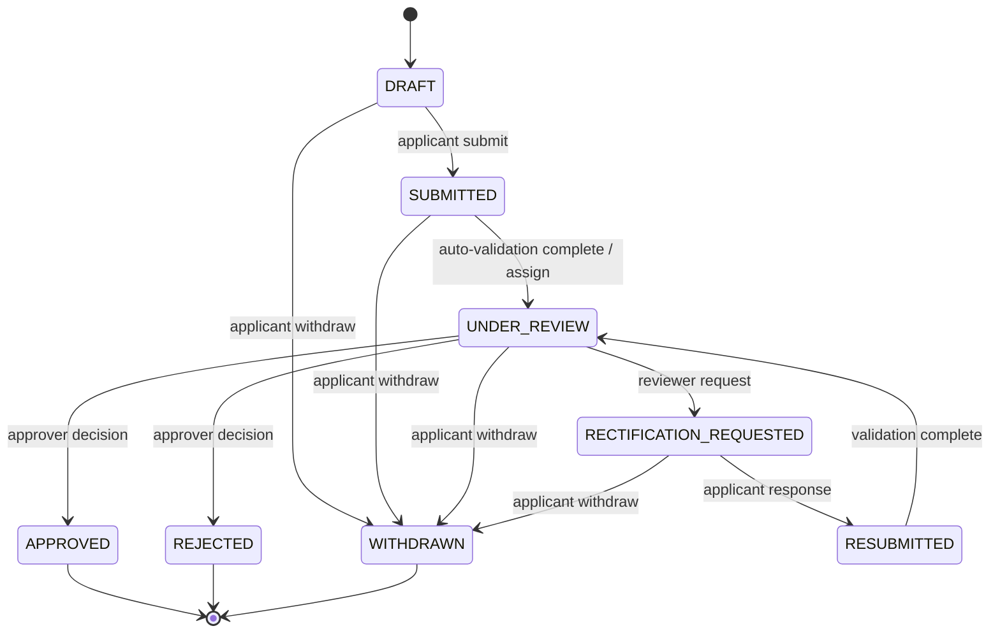

# API Contracts — AstraVerify (AICTE Adaptation)

**Status:** implemented prototype; target contracts retained where they describe future work
**Base URL:** `/api/v1`
**Format:** JSON (`application/json`) except uploads (`multipart/form-data`)
**Companion documents:** [`ARCHITECTURE.md`](ARCHITECTURE.md) · [`DATA_MODEL.md`](DATA_MODEL.md) · [`SPEC.md`](../SPEC.md)

FastAPI generates the authoritative live schema at `/api/v1/openapi.json` and `/docs`. This document records conventions/authorization plus the **as-built delta** below. Sections that describe target-only behavior are marked or superseded here.

---

## 1. Conventions

| Topic | Rule |
|---|---|
| IDs | UUID v4 strings |
| Timestamps | ISO-8601 UTC, `2026-10-23T09:15:00Z` |
| Dates | `YYYY-MM-DD` |
| Enums | Uppercase snake case (`UNDER_REVIEW`, `SOURCE_UNAVAILABLE`) |
| Money | Decimal string + `currency` (`"125000.00"`, `"INR"`) |
| Pagination | `page` (1-based), `page_size` (default 20, max 100); response `{items, page, page_size, total}` |
| Audit/alerts pagination | Keyset `cursor` + `limit`; response `{items, next_cursor}` |
| Auth | `Authorization: Bearer <access_token>` on every route except health/login/refresh |
| Idempotency | `Idempotency-Key: <uuid>` required on upload, submit, proof submission, review actions; 24 h retention |
| Concurrency | `If-Match: <version>` on mutable resource PATCH; `409 VERSION_CONFLICT` on mismatch |
| Request tracing | `X-Request-ID` accepted or generated; echoed in responses and logs |
| Content limits | JSON 1 MB; documents 25 MB; infrastructure video 100 MB; 1 file per request |
| Rate limits | Login 10/min/IP; uploads 60/h/user; proof submissions 30/h/user; default 300/min/user |
| Timezone | All server-side logic uses UTC |

### 1.1 Error envelope

```json
{
  "error": {
    "code": "VALIDATION_FAILED",
    "message": "One or more fields are invalid.",
    "details": [{"field": "cycle", "issue": "must match YYYY-YY"}],
    "request_id": "req_01J..."
  }
}
```

No stack traces, SQL, storage keys, or document text are returned in errors.

### 1.2 Error codes

| HTTP | Code | Meaning |
|---|---|---|
| 400 | `VALIDATION_FAILED` | Malformed/invalid input |
| 401 | `AUTH_REQUIRED` | Missing/invalid access token |
| 401 | `TOKEN_EXPIRED` | Access token expired; refresh required |
| 403 | `FORBIDDEN` | Role or object-level denial |
| 404 | `NOT_FOUND` | Resource absent or not visible to actor |
| 409 | `STATE_CONFLICT` | Invalid status transition |
| 409 | `VERSION_CONFLICT` | `If-Match` mismatch |
| 409 | `IDEMPOTENCY_CONFLICT` | Same key, different request body |
| 409 | `DUPLICATE_DOCUMENT` | Same content already exists for the document |
| 413 | `FILE_TOO_LARGE` | Exceeds 25 MB |
| 415 | `UNSUPPORTED_FILE` | Type/magic bytes not allowed |
| 422 | `PROCESSING_FAILED` | Document could not be processed |
| 429 | `RATE_LIMITED` | Limit exceeded; `Retry-After` set |
| 500 | `INTERNAL_ERROR` | Unexpected server error |
| 503 | `SOURCE_UNAVAILABLE` | Issuer/AICTE adapter unavailable |
| 503 | `CHAIN_UNAVAILABLE` | Chain RPC unavailable |
| 503 | `VERIFIER_UNAVAILABLE` | ZKP verifier unavailable |

### 1.3 Async pattern

**As built:** most operations run synchronously. Upload returns `202` for compatibility; processing/extraction/validation execute inline when enabled. Proof verification is synchronous; anchoring is invoked explicitly via `/api/v1/zkp/anchor`. There is no job queue/outbox. The target async pattern is described below:

1. Command returns `202 Accepted` with a resource ID and `status`.
2. Client polls the resource or uses the review queue.
3. Terminal states are explicit; partial failures are never reported as success.

### 1.4 Default read scope

Unless a route states otherwise, application-scoped resources are readable by:

- the applicant who owns the application,
- the assigned reviewer,
- an approver within scope,
- an administrator (read-only for case content),
- an auditor (read-only).

Object-level authorization still applies. Routes marked staff-only (for example institutional records and audit verification) exclude applicants. A `404` is returned for objects outside the actor's scope to avoid enumeration.

---

## 2. Authentication

### `POST /auth/login`

Public. Body:

```json
{"email": "reviewer@example.test", "password": "correct horse battery staple"}
```

`200`:

```json
{
  "access_token": "eyJ...",
  "refresh_token": "rt_...",
  "token_type": "Bearer",
  "expires_in": 900,
  "user": {
    "id": "0f3c...",
    "email": "reviewer@example.test",
    "full_name": "R. Menon",
    "role": "REVIEWER",
    "institution_id": null,
    "wallet_did": null
  }
}
```

Failures: `401 AUTH_REQUIRED` (generic message; no account enumeration), `429 RATE_LIMITED`. Failed attempts create a `security_event`.

### `POST /auth/refresh`

Public. Body `{"refresh_token": "rt_..."}`. Rotates the token; reuse of a revoked token revokes the family and returns `401`. `200` returns a new pair.

### `POST /auth/logout`

Authenticated. Body `{"refresh_token": "rt_..."}`. Revokes the token. `204`.

### `GET /auth/me`

Authenticated. Returns the current user and effective scopes.

### `POST /auth/password`

Authenticated. Body `{"current_password": "...", "new_password": "..."}`. `204`. All refresh tokens are revoked.

> **As built:** no public self-registration. Users are provisioned by `app.seed` or admin APIs. Demo credentials use `ChangeMe123!` unless `SEED_PASSWORD` is set. The system uses `email` as a plain string (not `EmailStr`) to allow demo domains like `.test`.

---

## 3. Institutions

| Method | Path | Roles | Purpose |
|---|---|---|---|
| `GET` | `/institutions/me` | APPLICANT | Own institution profile |
| `GET` | `/institutions` | ADMIN, AUDITOR | List institutions |
| `GET` | `/institutions/{id}` | APPLICANT (own), REVIEWER, APPROVER, ADMIN, AUDITOR | Profile |
| `PATCH` | `/institutions/{id}` | ADMIN | Update profile |
| `GET` | `/institutions/{id}/records` | REVIEWER, APPROVER, ADMIN, AUDITOR | Synthetic AICTE-style record bundle (all types) |
| `GET` | `/institutions/{id}/records/{type}` | REVIEWER, APPROVER, ADMIN, AUDITOR | One record type |

`{type}`: `approvals`, `programmes`, `faculty`, `deficiencies`, `ter`, `accreditations`, `nocs`.

Record response includes provenance:

```json
{
  "source": "synthetic-aicte-records",
  "synthetic": true,
  "retrieved_at": "2026-10-23T09:15:00Z",
  "items": [
    {
      "id": "9d1e...",
      "cycle": "2025-26",
      "status": "APPROVED",
      "valid_from": "2025-07-01",
      "valid_until": "2026-06-30",
      "synthetic": true
    }
  ]
}
```

Applicants do **not** read raw institutional records; they see derived findings and their own submitted data.

---

## 4. Applications and checklists

### `POST /applications`

Roles: APPLICANT (own institution). Body:

```json
{"category_code": "EOA", "cycle": "2026-27"}
```

`201`:

```json
{
  "id": "6a2f...",
  "reference_no": "APP-2026-000123",
  "institution_id": "b1c2...",
  "category_code": "EOA",
  "cycle": "2026-27",
  "status": "DRAFT",
  "checklist_template_id": "e7d4...",
  "version": 1,
  "submitted_at": null,
  "created_at": "2026-10-23T09:15:00Z"
}
```

The server snapshots the active checklist template onto the application and creates `application_checklist_items`.

### `GET /applications`

Roles: all, scoped. Query: `status`, `cycle`, `institution_id` (staff only), `assigned_to_me=true`, `q` (reference/no.), `page`, `page_size`.

Applicant scope: own institution. Reviewer: assigned or unassigned queue. Approver/Admin/Auditor: all (auditor read-only).

### `GET /applications/{id}`

Returns application + institution summary + checklist counts + latest validation summary + alert counts. Document text is never included.

### `PATCH /applications/{id}`

Roles: APPLICANT (own, `DRAFT` only). Body: `{"cycle": "2026-27"}` (only editable fields). Requires `If-Match`. A `SUBMITTED` application cannot be edited.

### `POST /applications/{id}/submit`

Roles: APPLICANT (own). Requires `Idempotency-Key`. Validates:

- All required checklist items have a document or a justification.
- Document processing is complete or explicitly failed (failed items block submission unless the checklist item is optional).
- At least the four required document types are present.

`202`:

```json
{"application_id": "6a2f...", "status": "SUBMITTED", "validation_run_id": "c9e1..."}
```

`409 STATE_CONFLICT` if not `DRAFT`/`RECTIFICATION_REQUESTED`.

### `POST /applications/{id}/withdraw`

Roles: APPLICANT (own). Allowed from `DRAFT`, `SUBMITTED`, `UNDER_REVIEW`, `RECTIFICATION_REQUESTED`. Requires `{"reason": "..."}`. `200` with `status: "WITHDRAWN"`.

### `GET /applications/{id}/checklist`

Returns the snapshot with status and linked document.

```json
{
  "application_id": "6a2f...",
  "items": [
    {
      "id": "f1...",
      "code": "AFFILIATION_CERTIFICATE",
      "title": "Affiliation/recognition certificate",
      "required": true,
      "status": "SATISFIED",
      "document_id": "d4...",
      "justification": null,
      "rule_codes": ["REQ_AFFILIATION", "AFFILIATION_EXPIRY"]
    }
  ]
}
```

### `PATCH /applications/{id}/checklist/{item_id}`

Roles: APPLICANT (own; `justification` only), REVIEWER/APPROVER (status `WAIVED`/`REJECTED` with rationale). Body:

```json
{"justification": "Affiliation renewal is in process; receipt attached.", "document_id": "d4..."}
```

`WAIVED` requires a rationale and writes an audit event.

### `GET /applications/{id}/self-check`

Roles: any user who can view the application; the natural caller is the applicant. `409 STATE_CONFLICT` unless the application is `DRAFT` or `RECTIFICATION_REQUESTED`.

Read-only pre-submission preview (`self-check-1.0`). It writes nothing — no validation run, no alerts, no audit event — and returns:

```json
{
  "application_id": "6a2f...",
  "reference_no": "APP-2026-000001",
  "status": "DRAFT",
  "check_version": "self-check-1.0",
  "generated_at": "2026-10-25T09:15:00Z",
  "can_submit": false,
  "counts": {"BLOCKING": 1, "WARNING": 2, "INFO": 1, "OK": 0},
  "checks": [
    {
      "code": "CHECKLIST_MISSING:AFFILIATION_CERTIFICATE",
      "level": "BLOCKING",
      "title": "Affiliation/recognition certificate",
      "message": "This required checklist item has no accepted document and no justification. Submission is blocked while it is incomplete.",
      "remediation": "Upload an accepted document for this item, or record a justification.",
      "details": {"checklist_code": "AFFILIATION_CERTIFICATE", "accepted_document_types": ["AFFILIATION_CERTIFICATE"]}
    }
  ],
  "advisory_note": "This self-check previews whether submission would be accepted and highlights likely findings. ..."
}
```

`can_submit` is `true` only when no required checklist item is missing. Blocking checks are exactly the items the `missing_required_items` helper returns, the same list `submit` enforces, so the preview cannot disagree with the real gate. Warnings and info are guidance only: rejected/unversioned documents outside the checklist gate, extraction problems, a missing/incomplete declaration, findings from the latest validation run, anomaly signals, and unavailable technical inspection. The self-check never runs the rule engine and never predicts approval.

### `GET /applications/{id}/declaration`

Roles: any user who can view the application (applicant of the institution, or staff/admin/auditor per the normal scope). Returns the applicant's declared facts or `null`:

```json
{
  "application_id": "6a2f...",
  "declaration": {
    "id": "8b1c...",
    "application_id": "6a2f...",
    "affiliation_number": "AFF/2026/001",
    "affiliation_valid_until": "2031-03-31",
    "programmes": [{"code": "CSE", "name": "B.Tech Computer Science and Engineering", "level": "UG", "intake": 120}],
    "total_intake": 180,
    "faculty_count": 2,
    "previous_approval_reference": "APP-2025-000421",
    "version": 2,
    "declared_by": "u3...",
    "created_at": "2026-10-25T09:00:00Z",
    "updated_at": "2026-10-25T09:14:00Z"
  }
}
```

`declaration` is `null` until the applicant saves one; the three declaration-consistency rules then report `NOT_AVAILABLE`.

### `PUT /applications/{id}/declaration`

Roles: APPLICANT (own institution) and only while the application is `DRAFT`; staff receive `403`, non-draft states `409`. Body:

```json
{
  "affiliation_number": "AFF/2026/001",
  "affiliation_valid_until": "2031-03-31",
  "programmes": [{"code": "CSE", "name": "B.Tech Computer Science and Engineering", "level": "UG", "intake": 120}],
  "total_intake": 180,
  "faculty_count": 2,
  "previous_approval_reference": "APP-2025-000421"
}
```

Upsert semantics: `200` with the saved declaration; `version` increments on each save and an `application.declaration_saved` audit event records changed field names. Programme codes are upper-cased, trimmed, and de-duplicated. Declared values are applicant-supplied and are not verified by this endpoint.

### `GET /applications/{id}/summary`

Dashboard projection:

```json
{
  "application_id": "6a2f...",
  "status": "UNDER_REVIEW",
  "checklist": {"total": 9, "satisfied": 7, "pending": 1, "waived": 1},
  "findings": {"PASS": 12, "FAIL": 2, "INCONCLUSIVE": 1, "NOT_AVAILABLE": 1, "NOT_APPLICABLE": 0},
  "verifications": {"VERIFIED": 2, "MISMATCH": 1, "EXPIRED": 0, "PENDING": 1, "SOURCE_UNAVAILABLE": 0, "MANUAL_REVIEW": 1},
  "anomalies": {"total": 2, "high": 0},
  "alerts": {"open": 3},
  "last_validation_run_id": "c9e1...",
  "chain": {"pending": 0, "confirmed": 4, "failed": 0}
}
```

### `GET /applications/{id}/status-history`

Returns `application_status_history` rows.

### Reports (implemented)

`GET /applications/{id}/report?format=json|markdown|html` — REVIEWER/APPROVER/ADMIN/AUDITOR, scoped like `review-overview`; applicants receive `403`. Returns the report body directly as an attachment (`Content-Disposition: attachment; filename="<reference_no>-report.<ext>"`); `format` defaults to `json`.

The report is a single synchronous render from current records (`application-report-1.0`): application summary, structured declaration (labelled applicant-supplied), checklist, documents and extraction status, latest validation run with findings and evidence metadata, technical inspections, issuer verifications, anomaly signals, infrastructure assessment, alerts with dispositions, review actions, decisions, and audit chain status. Every format embeds a `limitations` list stating that findings, anomalies, QR payloads, and signature structures are advisory, that issuer data is synthetic, and that the export is not an AICTE decision or certificate. Each export writes an `application.report_exported` audit event with the format.

There is no PDF renderer and no signature: an exported file is never a signed artefact. The earlier queued-report design (`POST /reports` → `GET /reports/{id}` with presigned download) is **not** implemented.

---

## 5. Documents and processing

### Document types

`AFFILIATION_CERTIFICATE`, `LAND_LEASE_DOCUMENT`, `FACULTY_DEGREE_CERTIFICATE`, `INSTITUTIONAL_UNDERTAKING`, `OTHER`.

`INFRASTRUCTURE_EVIDENCE` is an internal document type created only by the infrastructure-evidence endpoint; it is not accepted by the generic upload route. Allowed upload formats: PDF, JPEG, PNG. Max 25 MB (infrastructure video up to 100 MB). Server verifies magic bytes and PDF structure; MIME is not trusted.

### `POST /applications/{id}/documents`

Roles: APPLICANT (own, `DRAFT`/`RECTIFICATION_REQUESTED`). `multipart/form-data`:

| Field | Required | Notes |
|---|---|---|
| `file` | yes | PDF/JPEG/PNG |
| `document_type` | yes | Enum above |
| `checklist_item_id` | no | Links to checklist snapshot |
| `document_id` | no | Provide to create a new version of an existing document |

`202`:

```json
{
  "document_id": "d4...",
  "document_version_id": "v2...",
  "version_no": 1,
  "sha256": "9f2c...",
  "status": "STORED",
  "processing_job_id": "j1..."
}
```

Errors: `413`, `415`, `409 DUPLICATE_DOCUMENT` (identical content already attached to the same application), `422`.

### `GET /applications/{id}/documents`

List with current version status, extraction status, and anomaly count. Never returns extracted text.

### `GET /documents/{id}`

Returns document + versions (metadata only) + current extraction summary.

### `POST /documents/{id}/versions`

Roles: APPLICANT (own, editable states). Multipart as above without `document_type` (inherited). `202`; previous version remains immutable.

### `GET /documents/{id}/versions`

Version history ordered by `version_no`.

### `GET /document-versions/{id}`

Metadata + processing status + extraction summary.

### `GET /document-versions/{id}/extraction`

```json
{
  "document_version_id": "v2...",
  "document_type": "FACULTY_DEGREE_CERTIFICATE",
  "classification_confidence": 0.94,
  "status": "COMPLETED",
  "confidence": 0.88,
  "extractor_version": "ocr-2026.10",
  "fields": [
    {
      "name": "holder_name",
      "raw_value": "Dr. A. Sharma",
      "normalized_value": "a sharma",
      "value_type": "TEXT",
      "page": 1,
      "bbox": [120, 240, 480, 268],
      "page_width": 595.0,
      "page_height": 842.0,
      "confidence": 0.91
    }
  ]
}
```

`page_width`/`page_height` describe the coordinate space of `bbox`: PDF text-layer boxes are in PDF points, OCR'd raster boxes are in pixels of the rasterised page. Clients need both to place a highlight on the rendered page.

If processing failed, `status` is `FAILED`/`UNREADABLE` and `error_code` is set; fields may be empty. `OCR_ENGINE_UNAVAILABLE` means the server's Tesseract binary is missing (a deployment problem), distinct from `NO_TEXT` (the document itself has no readable text).

### `POST /document-versions/{id}/reprocess`

Roles: REVIEWER/APPROVER/ADMIN. `202` with job ID. Reprocessing creates a new extraction attempt? **No** — it replaces the extraction for a version only if the version was not already used in a completed validation run; otherwise the response is `409 STATE_CONFLICT` and the user must upload a new version. This preserves the evidence referenced by past runs.

### `GET /document-versions/{id}/anomalies`

Returns signals with evidence and `advisory: true`:

```json
{
  "items": [
    {
      "id": "a1...",
      "type": "METADATA_EDITOR",
      "score": 0.72,
      "method_version": "pdf-heuristics-2026.10",
      "explanation": "PDF metadata indicates an image editor; this is a preliminary indicator, not proof of forgery.",
      "evidence": {"field": "producer", "value": "ExampleEditor 4.2"},
      "advisory": true
    }
  ]
}
```

### `POST /document-versions/{id}/download-url`

Roles: authorized case viewers + uploader. Returns `{"url": "...", "expires_at": "..."}` (≤ 5 min). Every access writes an audit event (`DOCUMENT_ACCESSED`).

---

## 6. Infrastructure evidence

### `POST /applications/{id}/infrastructure-evidence`

Roles: APPLICANT (own, editable states). Multipart:

| Field | Required | Notes |
|---|---|---|
| `file` | yes | PDF/JPEG/PNG/MP4 (video ≤ 100 MB) |
| `evidence_type` | yes | `PHOTO`, `VIDEO`, `FLOOR_PLAN`, `CERTIFICATE`, `OTHER` |
| `requirement_code` | no | Maps to a checklist requirement |
| `captured_at` | no | Date the evidence was captured |

`201`:

```json
{
  "id": "e1...",
  "document_version_id": "v5...",
  "evidence_type": "PHOTO",
  "requirement_code": "LAB_SPACE",
  "status": "PRESENT",
  "notes": null
}
```

The endpoint creates a `DOCUMENT` of type `INFRASTRUCTURE_EVIDENCE` plus the evidence row. No CV analysis is performed; status reflects presence/completeness only.

### `GET /applications/{id}/infrastructure-evidence`

List with document metadata and reviewer notes.

### `PATCH /infrastructure-evidence/{id}`

Roles: REVIEWER/APPROVER. Body `{"status": "INSUFFICIENT", "notes": "..."}`. Requires rationale for `INSUFFICIENT`/`INCONCLUSIVE`.

---

## 7. Validation runs and findings

### `POST /applications/{id}/validate`

Roles: REVIEWER/APPROVER/ADMIN. Body `{"rule_set_id": "..."}` (optional; defaults to active set). `202`:

```json
{"validation_run_id": "c9e1...", "status": "QUEUED"}
```

The server freezes a new institutional-record snapshot, selects the rule set, and evaluates. Revalidation is append-only.

### `GET /applications/{id}/validation-runs`

List runs (newest first) with status and summary.

### `GET /validation-runs/{id}`

```json
{
  "id": "c9e1...",
  "application_id": "6a2f...",
  "rule_set": {"id": "r1...", "code": "AICTE-EOA", "version": 3, "source_citation": "Synthetic demo ruleset"},
  "snapshot_id": "s1...",
  "status": "COMPLETED",
  "started_at": "2026-10-23T09:16:00Z",
  "completed_at": "2026-10-23T09:16:04Z",
  "summary": {"PASS": 12, "FAIL": 2, "INCONCLUSIVE": 1, "NOT_AVAILABLE": 1, "NOT_APPLICABLE": 0}
}
```

### `GET /validation-runs/{id}/findings`

Query: `outcome`, `severity`, `page`, `page_size`.

```json
{
  "items": [
    {
      "id": "f1...",
      "rule_code": "AFFILIATION_EXPIRY",
      "outcome": "FAIL",
      "severity": "HIGH",
      "explanation": "The affiliation certificate expired on 2026-06-30, before the application date.",
      "recommended_action": "Obtain a current affiliation certificate or a valid renewal receipt.",
      "rule_set_version": 3,
      "evidence": [
        {
          "kind": "DOCUMENT_FIELD",
          "document_version_id": "v2...",
          "field": "valid_until",
          "page": 1,
          "snippet": "Valid up to 30-06-2026"
        }
      ]
    }
  ],
  "page": 1,
  "page_size": 20,
  "total": 16
}
```

`NOT_AVAILABLE` is used when the authorized source is absent and the rule cannot be evaluated; it is not a pass.

### `GET /findings/{id}`

Full finding + evidence + rule definition snapshot.

### `GET /applications/{id}/findings`

Cross-run consolidated view; defaults to the latest completed run. Query: `outcome`, `severity`, `latest=true`.

---

## 8. Issuer verification

### `GET /issuers`

Roles: REVIEWER/APPROVER/ADMIN/AUDITOR. Returns adapter capabilities:

```json
{
  "items": [
    {
      "name": "synthetic-affiliation-board",
      "available": true,
      "simulated": true,
      "supports": ["AFFILIATION_CERTIFICATE"],
      "reason": "Synthetic adapter for demonstration"
    },
    {
      "name": "local-ed25519-issuer",
      "available": true,
      "simulated": false,
      "supports": ["FACULTY_DEGREE_CERTIFICATE"],
      "reason": "Local test issuer; not a government source"
    },
    {
      "name": "digilocker",
      "available": false,
      "simulated": true,
      "supports": [],
      "reason": "Authorization not available"
    }
  ]
}
```

### `POST /document-versions/{id}/issuer-verifications`

Roles: REVIEWER/APPROVER/ADMIN. Body:

```json
{"issuer_code": "demo", "credential_id": "urn:uuid:..."}
```

`issuer_code` is `demo` (default) or `external`; `credential_id` is optional and defaults to the newest active synthetic credential for the version. `201` returns an `IssuerVerificationOut`:

```json
{
  "id": "iv1...",
  "document_version_id": "dv1...",
  "issuer_credential_id": "ic1...",
  "adapter_code": "demo",
  "status": "VERIFIED",
  "message": "Ed25519 signature and document hash verified against the synthetic demo issuer key. This is not an AICTE or external issuer confirmation.",
  "evidence": {"synthetic": true, "document_sha256_match": true},
  "simulated_source": true,
  "verified_by": "u1...",
  "created_at": "2026-10-25T09:20:00Z"
}
```

`issuer_code=external` records `SOURCE_UNAVAILABLE` with `simulated_source: true`; no external source is configured.

### `POST /document-versions/{id}/technical-verifications`

Roles: REVIEWER/APPROVER/ADMIN. PDF and image versions only; other media types return `400 UNSUPPORTED_MEDIA_TYPE`. Runs local advisory inspection and records one row per adapter (`qr-payload`, image/PDF; `pdf-signature`, PDF only). `201` returns a list of `IssuerVerificationOut` rows:

```json
[
  {
    "adapter_code": "qr-payload",
    "status": "SOURCE_UNAVAILABLE",
    "message": "A QR payload was detected but was not resolved against any authorised source. ... no URL was fetched and no authenticity claim is made.",
    "evidence": {
      "state": "QR_PAYLOAD_DETECTED_UNVERIFIED",
      "engine_version": "technical-inspection-1.0",
      "advisory_only": true,
      "cryptographically_verified": false,
      "external_lookup_performed": false,
      "pages_scanned": 1,
      "payload_count": 1,
      "payloads": [
        {
          "page": 1,
          "payload_preview": "https://verify.example.test/d/ABC123",
          "payload_sha256": "...",
          "payload_length": 41,
          "is_url": true,
          "scheme": "https",
          "host": "verify.example.test",
          "not_fetched": true
        }
      ]
    },
    "simulated_source": false
  },
  {
    "adapter_code": "pdf-signature",
    "status": "SOURCE_UNAVAILABLE",
    "evidence": {
      "state": "PDF_SIGNATURE_PRESENT_UNVERIFIED",
      "covers_whole_document": true,
      "coverage_ratio": 0.94,
      "residual_bytes": 2048,
      "signature_fields": {"signer_name": "...", "signing_time": "...", "filters": ["Adobe.PPKLite"]},
      "cryptographically_verified": false,
      "trust_chain_checked": false,
      "revocation_checked": false
    }
  }
]
```

Evidence `state` values and their status mapping are normative in `docs/ARCHITECTURE.md` §6.10. In short: `NOT_FOUND` for absence, `SOURCE_UNAVAILABLE` for present-but-unverified or decoder-unavailable, `MISMATCH` for incomplete signature byte-range coverage, `ERROR` for inspection failure. The endpoint never fetches QR payloads and never verifies PDF signature cryptography.

### `GET /document-versions/{id}/issuer-verifications`

Returns the full verification history (latest first) for the version, including issuer checks and technical inspections.

### `GET /applications/{id}/review-overview`

Also returns `technical_verifications`: the newest inspection row per `(document_version_id, adapter_code)`. The full history stays available through the endpoint above.

### Demo credential issuance (not a real issuer)

`POST /demo/issuer/credentials` — ADMIN only, labeled demo.

```json
{
  "holder_did": "did:example:faculty-001",
  "document_type": "FACULTY_DEGREE_CERTIFICATE",
  "fields": {"holder_name": "A. Sharma", "degree": "M.Tech", "institution": "Example University"},
  "commitments": {"cgpa": {"scheme": "poseidon-bn254-v1", "value": "123456789..."}},
  "expires_at": "2027-06-30T00:00:00Z"
}
```

`201` returns the signed credential (`Ed25519` over RFC 8785 canonical JSON). The signature is real; the **issuer identity is demo-only**.

`GET /credentials/{id}` — holder, admin, or staff linked to a proof request.
`POST /credentials/{id}/revoke` — ADMIN. `204`.
`GET /wallet/credentials` — APPLICANT; returns credentials whose `holder_did` equals the user's `wallet_did`.

---

## 9. ZKP (as built)

**Implemented (current):** `GET /api/v1/zkp/status`, `POST /api/v1/zkp/challenges`, `POST /api/v1/zkp/proofs`, `GET /api/v1/zkp/applications/{application_id}/proofs`, `GET /api/v1/zkp/proofs/{proof_id}`, `POST /api/v1/zkp/anchor`. Circuits/artifacts: `faculty_threshold` (v2.0.0); verification uses a pinned vkey. The threshold is server-issued via the challenge (`FACULTY_THRESHOLD_SCALED`, default `700`). Public signals are five decimal strings in order `[valid, nullifier, commitment, threshold, requestHash]`. Raw proof JSON and private inputs are not returned. Nullifiers are globally unique; challenges are consumed only after successful verification. Anchoring is optional via `/api/v1/zkp/anchor`.

The sections below are a **target contract** and are **not implemented**. Use the current endpoints.

### `GET /zkp/config`

Authenticated. Returns pinned artifact metadata:

```json
{
  "circuit_id": "threshold_proof-v1",
  "vkey_id": "threshold_proof-v1-2026-10",
  "public_signal_order": ["valid", "nullifier", "commitment", "threshold", "requestHash"],
  "wasm_url": "/circuits/threshold_proof.wasm",
  "zkey_url": "/circuits/threshold_proof_final.zkey",
  "sha256": {"wasm": "...", "zkey": "...", "vkey": "..."},
  "demo_only": true
}
```

### `POST /zkp/requests`

Roles: REVIEWER/APPROVER/ADMIN. Body:

```json
{
  "application_id": "6a2f...",
  "credential_id": "cr1...",
  "field": "cgpa",
  "operator": "GTE",
  "threshold_scaled": 750
}
```

`201`:

```json
{
  "id": "zr1...",
  "request_hash": "123456789...",
  "nonce": "0c2d...",
  "expires_at": "2026-10-23T10:15:00Z",
  "status": "PENDING"
}
```

`request_hash = SHA-256(RFC8785({request_id, application_id, credential_id, field, operator, threshold_scaled, nonce, expires_at, circuit_id, vkey_id})) mod p`. The server recomputes it at proof time; the client never supplies it.

### `GET /zkp/requests/{id}`

Roles: requester staff, holder (`wallet_did` matches credential), ADMIN. Returns request + proof status.

### `GET /zkp/requests?application_id=&status=`

Roles: REVIEWER/APPROVER/ADMIN. Scoped list.

### `POST /zkp/requests/{id}/proof`

Roles: APPLICANT (holder). Requires `Idempotency-Key`. Body:

```json
{
  "holder_did": "did:example:faculty-001",
  "circuit_id": "threshold_proof-v1",
  "vkey_id": "threshold_proof-v1-2026-10",
  "proof": {"pi_a": ["..."], "pi_b": [["..."]], "pi_c": ["..."], "protocol": "groth16", "curve": "bn128"},
  "public_signals": ["1", "123...", "456...", "750", "789..."]
}
```

Server checks:

1. Request exists, is `PENDING`, not expired, and belongs to the holder's credential.
2. `circuit_id`/`vkey_id` match the pinned config.
3. Public-signal order and types are valid; `threshold` equals `threshold_scaled`; `requestHash` matches; `valid == 1`.
4. `commitment` equals the credential's commitment for the field.
5. `nullifier` has not been used.
6. `zkp-verifier` returns `valid: true` for the pinned vkey.
7. Subject to all checks, status becomes `VERIFIED`; otherwise `REJECTED` with a stable `reason_code` (`REQUEST_EXPIRED`, `REQUEST_HASH_MISMATCH`, `THRESHOLD_MISMATCH`, `COMMITMENT_MISMATCH`, `NULLIFIER_REUSED`, `PROOF_INVALID`, `VKEY_UNKNOWN`).

`200`:

```json
{
  "proof_id": "zp1...",
  "status": "VERIFIED",
  "nullifier": "123...",
  "verified_at": "2026-10-23T09:31:00Z",
  "anchor_id": "ch1..."
}
```

### `GET /zkp/proofs/{id}`

Returns the proof result, public signals, circuit/vkey IDs, and anchor status. It never returns the private value or blinding.

---

## 10. Chain (as built)

**Implemented:** `POST /api/v1/zkp/anchor` anchors a verified proof. There is no `/chain/*` CRUD/listing/retry/verify API; anchors are inspected via the proof record (`chain_status`, `chain_tx_hash`, `chain_network`, `anchored_at`, `error_message`). Contract access is role-restricted (`ANCHOR_ROLE`); revocation and retries are not implemented. The routes below are **target-only**.

### `GET /chain/status` (target, not implemented)

Authenticated. `{"enabled": true, "chain_id": 31337, "contract_address": "0x...", "latest_block": 42, "confirmations_required": 1, "available": true}`.

### `GET /chain/anchors?kind=&subject_hash=`

Roles: REVIEWER/APPROVER/ADMIN/AUDITOR. Returns anchor records with `status`, `tx_hash`, `block_number`, `confirmations`.

### `GET /chain/anchors/{id}`

Anchor detail + subject type.

### `POST /chain/anchors/{id}/retry`

ADMIN only. `202`. Allowed only for `FAILED` (or stale `PENDING`).

### `GET /chain/verify?kind=&subject_hash=`

Roles: staff/auditor. Checks the local record and (if available) the chain:

```json
{
  "kind": "DOCUMENT",
  "subject_hash": "0x9f2c...",
  "local_status": "CONFIRMED",
  "on_chain_match": true,
  "checked_at": "2026-10-23T09:40:00Z",
  "disclaimer": "A matching hash shows the anchored value is unchanged. It does not prove the document is authentic or truthful."
}
```

The disclaimer is mandatory in both API and UI. Hash convention: documents anchor `0x` + SHA-256; credentials and proof results anchor `keccak256` of their canonical JSON. A matching hash shows the anchored value is unchanged; it does not prove authenticity.

---

## 11. Review, alerts, decisions

### `GET /review/queue`

Roles: REVIEWER/APPROVER/ADMIN. Query: `status`, `severity`, `assigned_to_me`, `q`, `page`, `page_size`. Returns applications with open alert counts and highest severity.

### `GET /applications/{id}/review-overview`

Roles: REVIEWER/APPROVER/ADMIN/AUDITOR (applicants cannot call it). One read that the compliance console renders: application summary, checklist, documents, latest validation run with findings and their evidence, infrastructure assessment, actions, alerts, and decisions.

`documents[]` entries carry what a viewer needs to open the stored file:

```json
{
  "id": "d2...",
  "document_type": "AFFILIATION_CERTIFICATE",
  "status": "PROCESSED",
  "current_version_id": "v4...",
  "original_filename": "affiliation_2026.pdf",
  "mime_type": "application/pdf",
  "created_at": "2026-10-25T09:12:44Z"
}
```

`latest_validation_run.findings[].evidence[].metadata_json` carries the extraction provenance used to highlight a finding in the document: `document_id`, `document_version_id`, `field`, `page`, `bbox`, `page_width`, `page_height`, `confidence`. Evidence is advisory: a located box does not establish authenticity.

The response also includes `declaration` (the same object as `GET /applications/{id}/declaration`, or `null`) so reviewers can compare declared values with extracted fields and synthetic records without a second call. Declaration-based findings use evidence types `DECLARATION` (applicant-supplied facts, `advisory: true`) and `RECORD` (synthetic institutional records); certificate comparisons also carry `EXTRACTED_FIELD` evidence with page geometry.

### `POST /applications/{id}/assign`

Roles: REVIEWER (self-assign only if unassigned), APPROVER/ADMIN (any reviewer). Body `{"reviewer_id": "..."}`. `200`. Audited.

### `POST /applications/{id}/actions`

Roles: REVIEWER/APPROVER. Body:

```json
{
  "action_type": "REQUEST_RECTIFICATION",
  "rationale": "Affiliation certificate is expired; please upload the current certificate.",
  "payload": {"finding_ids": ["f1..."], "due_at": "2026-11-06"}
}
```

Allowed types: `NOTE`, `ASSIGN`, `REQUEST_RECTIFICATION`, `ESCALATE`, `RECOMMEND_APPROVE`, `RECOMMEND_REJECT`. Applicants respond through `POST /applications/{id}/rectification-responses` (below) so role checks stay simple.

`201` returns the action. Status transitions occur only for `REQUEST_RECTIFICATION` (→ `RECTIFICATION_REQUESTED`) and `ESCALATE` (no status change, record only).

### `POST /applications/{id}/rectification-responses`

Roles: APPLICANT (own). Body `{"message": "...", "document_version_ids": ["v3..."]}`. `201`. Moves `RECTIFICATION_REQUESTED` → `RESUBMITTED` and enqueues validation.

### `GET /applications/{id}/actions`

Roles: case viewers. Chronological review actions.

### `POST /applications/{id}/decisions`

Roles: APPROVER only. Body:

```json
{"decision": "APPROVED", "rationale": "All mandatory requirements met; residual anomalies reviewed and closed.", "scope": "EoA 2026-27"}
```

`201`. `409 STATE_CONFLICT` unless the application is `UNDER_REVIEW` and the approver has scope. The decision is final; no update endpoint exists. The audit event records the approver, rationale, and timestamp.

### `GET /applications/{id}/decisions`

Case viewers. Returns the final decision (if any).

### Alerts

| Method | Path | Roles | Purpose |
|---|---|---|---|
| `GET` | `/alerts` | REVIEWER/APPROVER/ADMIN/AUDITOR | List, filter `status`, `alert_type`, `application_id` |
| `GET` | `/applications/{id}/alerts` | Any viewer of the application | Alerts for one application, optional `status` |
| `GET` | `/alerts/{id}` | REVIEWER/APPROVER/ADMIN/AUDITOR | Alert detail; `404` when the alert's application is outside the caller's scope |
| `POST` | `/alerts/{id}/acknowledge` | REVIEWER/APPROVER/ADMIN | `200`; records actor/time; `409` when already resolved |
| `POST` | `/alerts/{id}/resolve` | REVIEWER/APPROVER/ADMIN | Body `{"disposition": "...", "note": "..."}`; `200` |

`disposition` is one of `ADDRESSED` (default), `FALSE_POSITIVE`, `DUPLICATE`, `SUPERSEDED`, `ACCEPTED_RISK`, `ESCALATED`. `FALSE_POSITIVE` and `ACCEPTED_RISK` require a non-blank `note` (`400 VALIDATION_FAILED`). The disposition and note are stored in the alert's `payload` and written to the `alert.resolved` audit event; `AlertOut.disposition` exposes the stored value.

Alerts are unique on `(application_id, alert_type, source_ref)`. Findings and anomaly signals get new row IDs on each validation run, so `sync_alerts` resolves alerts whose source is no longer in the latest run as `SUPERSEDED` with `resolved_by = null` and an `alert.superseded` audit event. Human-created rectification and escalation alerts are never auto-resolved. A disposition is human judgement only: it never changes a finding outcome and never rejects an application.

---

## 12. Audit

### `GET /applications/{id}/audit`

Roles: applicant (own events only), reviewer/approver (assigned/scope), admin, auditor. Returns audit events for the application and its child objects, newest first. Keyset pagination.

### `GET /audit`

Roles: ADMIN, AUDITOR. Filters: `object_type`, `object_id`, `actor_id`, `action`, `from`, `to`, `cursor`, `limit`.

### `GET /audit/verify`

Roles: ADMIN, AUDITOR. Query `from_seq`, `to_seq`. Recomputes the hash chain and returns:

```json
{"checked": 1240, "valid": true, "first_seq": 1, "last_seq": 1240, "broken_at": null}
```

### `GET /audit/export`

Roles: AUDITOR, ADMIN. `format=jsonl`. Streams events with hashes. Audited.

Every audit event includes `seq`, `action`, `object_type`, `object_id`, `actor_type`, `actor_id`, `created_at`, `prev_hash`, `event_hash`.

---

## 13. Administration

All routes below require `ADMIN` unless stated.

| Method | Path | Purpose |
|---|---|---|
| `GET/POST` | `/admin/users` | List/create users (`email`, `full_name`, `role`, `institution_id`, `wallet_did`, temp password) |
| `PATCH` | `/admin/users/{id}` | Update role/institution/active status; cannot demote the last admin |
| `POST` | `/admin/users/{id}/reset-password` | Issue a one-time temporary password; revokes tokens |
| `GET/POST` | `/admin/categories` | List/create application categories (EoA seeded) |
| `GET/POST` | `/admin/checklist-templates` | List/create templates (nested items) |
| `POST` | `/admin/checklist-templates/{id}/activate` | Activate; retires the previous active template |
| `GET/POST` | `/admin/rule-sets` | List/create draft rule sets with rules |
| `POST` | `/admin/rule-sets/{id}/activate` | Activate; retires previous active set; immutable afterward |
| `GET` | `/admin/rule-sets/{id}/rules` | Rule details |
| `GET` | `/admin/integrations` | Adapter capabilities and `simulated` flags |
| `GET` | `/admin/system` | Build/version, migrations head, queue depth |

Rule set creation example:

```json
{
  "code": "AICTE-EOA",
  "version": 3,
  "effective_from": "2026-10-01",
  "source_citation": "Synthetic demo rules; replace with Approval Process Handbook citations",
  "rules": [
    {
      "code": "AFFILIATION_EXPIRY",
      "title": "Affiliation certificate must be valid on the submission date",
      "rule_type": "DOCUMENT_EXPIRY",
      "severity": "HIGH",
      "config": {"document_type": "AFFILIATION_CERTIFICATE", "field": "valid_until", "compare_to": "submitted_at"},
      "recommended_action": "Obtain a current affiliation certificate."
    }
  ]
}
```

Activation validates all rule configs and computes a checksum.

---

## 14. Health and operations

| Method | Path | Auth | Purpose |
|---|---|---|---|
| `GET` | `/health` | none | Liveness; `{"status":"ok"}` |
| `GET` | `/ready` | none | DB + object store; chain optional; `503` if not ready |
| `GET` | `/openapi.json` | none | OpenAPI schema (demo; can be disabled) |
| `GET` | `/metrics` | internal only | Prometheus metrics; not proxied publicly |

`/ready` must not reveal credentials or internal hostnames.

---

## 15. Authorization matrix (summary)

| Resource/action | APPLICANT | REVIEWER | APPROVER | ADMIN | AUDITOR |
|---|---|---|---|---|---|
| Application create/edit (draft) | own | — | — | — | — |
| Submit/withdraw | own | — | — | — | — |
| Upload version | own, editable states | — | — | — | — |
| View application | own | assigned/scope | scope | all | all (read) |
| Trigger validation | on submit | assigned | scope | any | — |
| Issuer verification | — | assigned | scope | any | — |
| Institutional records | — | scope | scope | all | all (read) |
| Anomaly signals | own docs | scope | scope | all | all (read) |
| Review actions | rectification response only | assigned | scope | — | — |
| Final decision | — | — | delegated scope | — | — |
| Rule/checklist admin | — | — | — | ✅ | — |
| Audit read | own events | assigned | scope | all | all |
| Audit verify/export | — | — | — | ✅ | ✅ |
| Chain retry/revoke | — | — | — | ✅ | — |
| Demo credential issue | — | — | — | ✅ (demo) | — |

Object-level checks are mandatory even where a role is allowed; `404` is returned for objects outside the actor's scope to avoid enumeration.

---

## 16. Application state transitions



Invalid transitions return `409 STATE_CONFLICT`. Every transition is audited with actor and reason.

---

## 17. Validation semantics (normative)

1. A validation run is bound to exactly one immutable `rule_set` and one immutable `institutional_record_snapshot`.
2. Rule evaluation is deterministic and performs no network I/O.
3. Each rule produces exactly one finding with an outcome:
   - `PASS` — requirement satisfied by evidence.
   - `FAIL` — requirement not satisfied.
   - `INCONCLUSIVE` — evidence exists but cannot be reliably interpreted.
   - `NOT_AVAILABLE` — the authorized source/record needed to evaluate is absent.
   - `NOT_APPLICABLE` — rule does not apply to this application (recorded, not silently skipped).
4. `FAIL` and `INCONCLUSIVE` findings carry evidence and a recommended action.
5. A missing document for a required item yields `FAIL`; an expired document yields `FAIL`; an absent institutional record yields `NOT_AVAILABLE` (never `PASS`).
6. Re-running validation never mutates an earlier run; it appends a new run and new findings.
7. Findings are advisory. The API never returns a field named `forged`, `authentic`, or `guilty`; it returns signals and statuses.
8. Three-way consistency rules (`AFFILIATION_DECLARATION_MATCH`, `PROGRAMME_DECLARATION_MATCH`, `FACULTY_COUNT_DECLARATION_MATCH`) compare applicant-declared values with extracted document fields and/or synthetic records. Without a saved declaration they return `NOT_AVAILABLE`; a mismatch is `FAIL` with the compared values in `details` (`declared`, `extracted`, `mismatches`, or `declared_codes`/`record_codes`/`intake_mismatches`). They never auto-reject or label a declaration as false.

---

## 18. Open contract questions

1. Confirm whether applicants may view redacted institutional records (currently denied).
2. Confirm final decision scope/delegation model (single approver vs committee).
3. Confirm report formats required by AICTE (PDF layout/JSON schema).
4. Confirm alert delivery channels beyond in-app (email/SMS out of scope).
5. Confirm whether issuer verification must be retried automatically or only manually.
6. Confirm whether to bind the ZKP to an issuer-issued Poseidon commitment and private payload delivery (currently not implemented).
