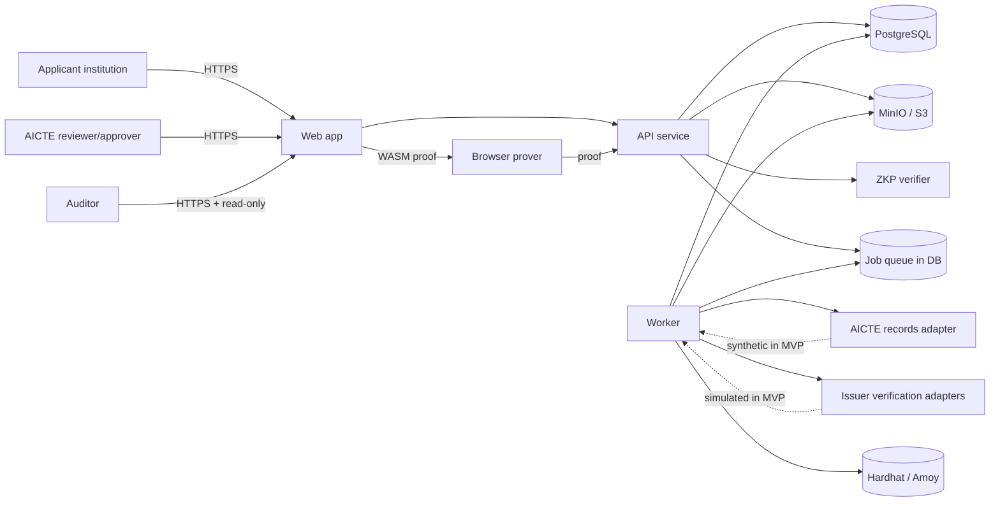
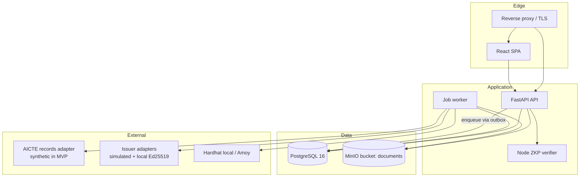
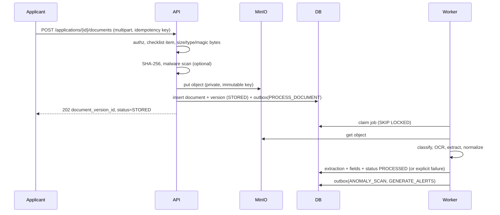
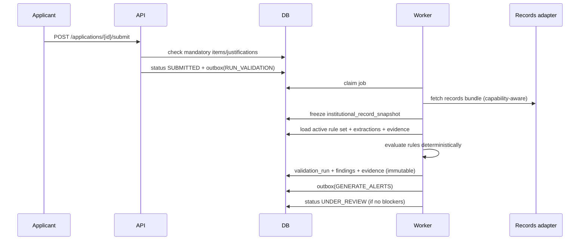
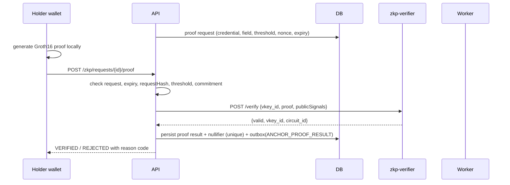

# Architecture — AstraVerify (AICTE Adaptation)

**Status:** target architecture with as-built delta (Phases 3–10 implemented)
**Last updated:** 2026-10-24
**Companion documents:** [`SPEC.md`](../SPEC.md) · [`DATA_MODEL.md`](DATA_MODEL.md) · [`API_CONTRACTS.md`](API_CONTRACTS.md) · [`TEST_PLAN.md`](TEST_PLAN.md)

---

## 1. Purpose

Define the target architecture for an EoA-focused, AI-assisted decision-support platform that validates institutional applications, supports document authentication, checks configurable regulatory requirements, and produces evidence-linked findings for authorized human review.

The architecture must:

- Be implementable by a small team within the SIH timeframe.
- Reuse the working FastAPI/React/OCR foundation.
- Enforce security and tenancy from the start.
- Keep AI and anomaly outputs advisory and explainable.
- Treat external sources (AICTE, issuers, chain) as unavailable unless explicitly authorized.
- Keep ZKP and blockchain in the MVP without letting them block core workflows.

### 1.1 As-built delta (important)

The diagrams and later sections describe the **target** architecture. The current prototype differs in these ways:

| Target | As built |
|---|---|
| FastAPI + separate worker + outbox/jobs | Modular monolith; processing, validation, issuer checks, alerts, and anchoring run inline (upload returns `202` for compatibility). No worker/outbox service. |
| Separate Node `zkp-verifier` service | In-process Python service invokes `snarkjs` and verifies with a pinned vkey under `backend/circuits/faculty_threshold/`. |
| MinIO/S3 mandated | Storage abstraction: `local` for tests/dev, `s3` supported by config. Local downloads use HMAC-signed URLs. |
| Docker Compose stack/Dockerfile | No Compose file or backend Dockerfile is committed. PostgreSQL runs in a local container; backend/frontend run from source. |
| Job queue/retries | Synchronous calls; anchoring is a single optional attempt with explicit `FAILED` state. |
| Transactional outbox | Not implemented; audit/status writes share the request transaction. |
| Retention job, encryption-at-rest, KMS | Not implemented; documented as gaps. |
| Proxy/TLS in compose | Not provided; use a reverse proxy for any non-local deployment. |

The implemented service boundaries are `app/routers/*` + `app/services/*`; see `docs/API_CONTRACTS.md`, `docs/DATA_MODEL.md`, and `docs/TEST_PLAN.md` §14 for what was executed.

---

## 2. Architectural drivers and constraints

| Driver | Consequence |
|---|---|
| Regulatory decisions are human | No automated decision endpoint; approver role required |
| Evidence must be traceable | Immutable document versions, rule snapshots, evidence-linked findings, hash-chained audit |
| Sources may be unavailable | Explicit adapter capabilities; `NOT_AVAILABLE` outcome; no silent fallback |
| Data is confidential | Private object storage, per-object authorization, encrypted volumes, redacted logs |
| Rules change | Immutable rule-set versions; applications pin to the version used |
| ZKP must be sound | New circuit, Poseidon commitment, server verification, replay protection |
| Chain is tamper-evidence only | Non-blocking anchoring, retries, visible status |
| Small team / demo | Modular monolith + one worker + one verifier service; no microservice sprawl |

---

## 3. System context



**Trust boundaries:** browser (untrusted), API edge, private data plane (API/worker/DB/object store), external adapters and chain (untrusted responses).

---

## 4. Container view



### 4.1 Services

**As-built:** only `web`, `api`, `postgres`, optional object storage, and optional Hardhat run. There is no worker, proxy, `zkp-verifier`, or `minio-init` service in the repository. The table is the target split.

| Service | Responsibility | Stateless? |
|---|---|---|
| `web` | React SPA; applicant, reviewer, issuer-demo, wallet/prover views | Yes |
| `proxy` | TLS termination, static assets, `/api` reverse proxy, security headers | Yes |
| `api` | Auth, authorization, CRUD, validation orchestration, ZKP verification calls, review actions, audit reads | Yes |
| `worker` | Document processing, validation runs, issuer verification, anchoring, alert generation, audit-chain checks | Yes |
| `zkp-verifier` | Pinned Groth16 verification via snarkjs; no database access | Yes |
| `postgres` | Source of truth for all relational state | Persistent |
| `minio` | Immutable document/evidence objects | Persistent |
| `hardhat` (optional) | Local demo chain | Ephemeral |
| `minio-init` | Bucket creation/policy on startup | One-shot |

No service writes another service's tables directly; all cross-module effects go through service interfaces or the job/outbox mechanism.

---

## 5. Backend module boundaries

The backend remains a modular monolith. Each module owns its tables and exposes a service interface.

| Module | Owns | Key interfaces |
|---|---|---|
| `identity` | `users`, `refresh_tokens` | `authenticate`, `issue_tokens`, `require_role`, `authorize_object` |
| `institutions` | `institutions` | `get_institution`, `assert_membership` |
| `applications` | `applications`, `application_categories`, `checklist_templates`, `application_checklist_items` | `create_application`, `snapshot_checklist`, `submit`, `withdraw` |
| `documents` | `documents`, `document_versions`, `infrastructure_evidence` | `intake`, `new_version`, `presign_get`, `list_versions` |
| `processing` | `extractions`, `extracted_fields`, `jobs` | `process_version`, `classify`, `extract_fields` |
| `records` | `approval_history`, `programmes`, `faculty_records`, `compliance_deficiencies`, `ter_payments`, `accreditation_records`, `nocs_permissions`, `institutional_record_snapshots` | `fetch_bundle`, `freeze_snapshot` |
| `rules` | `rule_sets`, `rules`, `validation_runs`, `findings`, `finding_evidence` | `evaluate`, `explain`, `revalidate` |
| `issuers` | `issuer_verifications`, `issuer_keys`, `credentials` | `verify_document`, `issue_credential`, `verify_signature` |
| `anomaly` | `anomaly_signals` | `analyze_version` |
| `zkp` | `zk_proof_requests`, `zk_proofs` | `create_request`, `verify_submission` |
| `anchoring` | `chain_anchors`, `jobs` | `enqueue_anchor`, `record_confirmation`, `retry` |
| `review` | `review_actions`, `decisions`, `alerts` | `assign`, `note`, `request_rectification`, `escalate`, `recommend`, `decide` |
| `audit` | `audit_events`, `audit_chain_state` | `append`, `query`, `verify_chain` |

Cross-module rule: no imports of another module's ORM models. Use DTOs and service calls.

---

## 6. Runtime flows

### 6.1 Upload and processing



If object upload succeeds but the DB transaction fails, the API deletes the object (compensating action). Version rows are immutable; corrections create new versions.

### 6.2 Submit and validate



External calls happen **before** evaluation. The rule engine receives a frozen context and performs no I/O, which makes outcomes reproducible.

### 6.3 Issuer verification

1. Worker selects adapter by document type and adapter capabilities.
2. Adapter returns `{status, source, simulated, response_ref, fields, retrieved_at}`.
3. Response is validated against a schema; unknown fields are ignored.
4. `issuer_verifications` row is written; simulated responses carry `simulated: true`.
5. If the adapter is unavailable or inconclusive, status is `SOURCE_UNAVAILABLE` or `MANUAL_REVIEW`.

### 6.4 ZKP verification

**As built:** the API creates a stored challenge, then the client proves in the browser. Submission is verified in-process with snarkjs and a pinned vkey; there is no separate verifier service. The sequence below is the target separation.



The verifier service only holds verification keys and snarkjs. It has no database or object-store access. Public-signal order is fixed and validated before calling snarkjs.

### 6.5 Anchoring

**Target:** durable outbox, worker, confirmations, retries.

**As built:** the proof row has `chain_status` (`DISABLED`, `PENDING`, `ANCHORED`, `FAILED`). On request, the API exports Solidity calldata from snarkjs and submits one `verifyAndAnchor` transaction with `web3.py`, then stores the tx hash or error. There is no outbox, confirmation polling, or retry queue. Failures never block review or decisions. The UI shows the explicit status.

### 6.6 Review and audit

- Reviewer actions are commands with validation, rationale, and an audit event in the same transaction.
- Decisions require `APPROVER` role and a recorded scope; AI outputs are never inputs to an automatic decision.
- Audit insertion serializes on `audit_chain_state` (row lock) to maintain a strict hash chain. Failed/denied requests go to a separate security log, not the business audit chain.

---

## 7. Data architecture

| Data | Store | Notes |
|---|---|---|
| Relational state | PostgreSQL | Source of truth; transactional; migrations via Alembic |
| Documents/evidence | MinIO/S3 | Private bucket, SSE, immutable keys, SHA-256 recorded |
| Circuit artifacts | `zkp/` image + `frontend/public/circuits/` | Versioned; pinned vkey ID |
| Audit | PostgreSQL append-only | Hash chain; no update/delete grants |
| Jobs/outbox | PostgreSQL | Durable, `SKIP LOCKED`, retries |
| Chain | Hardhat/Amoy | Hashes/commitments only; not authoritative |

**Immutability:** `document_versions`, completed `validation_runs`, `findings`, `issuer_verifications`, `audit_events`, and `institutional_record_snapshots` are insert-only. Updates are limited to status fields explicitly listed in `DATA_MODEL.md`.

**Dual-write avoidance:** object storage is written before the DB transaction; compensating deletion on failure. Side effects (jobs, anchors) use a transactional outbox.

---

## 8. Job and outbox model (target, not implemented)

The prototype has **no durable job queue or outbox**. Work runs inline by default (`PROCESS_DOCUMENTS_INLINE=true`). The following is the target design for production hardening:

- `outbox_events` is written in the same transaction as the business change.
- A dispatcher (worker loop) converts events into `jobs` rows idempotently.
- `jobs` are claimed with `SELECT … FOR UPDATE SKIP LOCKED`, with `locked_by`, `locked_at`, `attempts`, `run_at`.
- Job types: `PROCESS_DOCUMENT`, `SCAN_ANOMALIES`, `RUN_VALIDATION`, `VERIFY_ISSUER`, `ANCHOR_DOCUMENT`, `ANCHOR_CREDENTIAL`, `ANCHOR_PROOF`, `GENERATE_ALERTS`, `VERIFY_AUDIT_CHAIN`.
- Retry: exponential backoff (5s → 5m), max 5 attempts; then `DEAD` + alert.
- Jobs are idempotent using a natural key (e.g., `document_version_id:PROCESS_DOCUMENT`).
- The worker is horizontally scalable; no in-process background tasks for durable work.

---

## 9. Security architecture

### 9.1 Authentication and authorization

- Local accounts; Argon2id password hashing; JWT access (15 min) + rotating refresh (7 days) stored hashed.
- Tokens include `sub`, `role`, `institution_id`, `jti`, `exp`.
- Shared dependencies: `require_authenticated`, `require_role(...)`, `authorize_application(actor, application)`.
- Object-level checks are mandatory on every route; route-level roles are necessary but not sufficient.
- Auditor is read-only. Admin cannot make regulatory decisions.

### 9.2 Trust boundaries and threats

| Threat | Control |
|---|---|
| Forged/stolen tokens | Short expiry, refresh rotation/revocation, HTTPS, secure cookie/local storage guidance |
| Cross-tenant IDOR | Object-level authorization tests on every resource type |
| Malicious upload | Type/size/magic-byte checks, PDF structure validation, image decode, optional ClamAV, parser isolation, no execution |
| Path traversal / SSRF | Randomized keys; adapters use allowlisted endpoints; no user-supplied URLs |
| Audit tampering | Append-only grants, hash chain, periodic verification job |
| Simulated data mistaken for real | `simulated`/`synthetic` fields required by schemas; UI badges; tests |
| Proof replay | Request binding, nonce, nullifier uniqueness, expiry |
| Chain key theft | Demo key only in env; production KMS out of scope; least-privilege roles |
| Prompt injection | Documents are data; no tool access; schema validation; injection tests |
| Log leakage | Redaction of tokens/passwords/document text; structured logging |
| Dependency compromise | Pinned lockfiles, audit scans, image scanning in CI |

### 9.3 Secrets

`JWT_SECRET` and `DOWNLOAD_SIGNING_KEY` are required and must each be at least 32 characters; startup fails otherwise. Production also requires explicit `CORS_ORIGINS` and `STORAGE_BACKEND=s3`. S3 credentials (`S3_*`) and blockchain settings (`BLOCKCHAIN_PRIVATE_KEY`, `ASTRA_VERIFY_ANCHOR_ADDRESS`, `BLOCKCHAIN_RPC_URL`) are optional unless the corresponding feature is enabled. No secrets are committed; `.env.example` contains placeholders only.

### 9.4 Data protection

**Implemented:** ownership checks, short-lived signed download URLs, private local storage or S3-compatible object storage, security headers, request IDs, and audit/access events. Raw document text is not exposed in list endpoints or logs.

**Not implemented (production gap):** TLS termination is deployment-specific; MinIO SSE config is deployment-specific; encrypted PostgreSQL volume/least-privilege roles are deployment-specific; automated retention/deletion and field-level encryption are absent. Backups are out of scope for the demo.

---

## 10. Error handling and reliability

- Standard error envelope: `{error: {code, message, details?, request_id}}`.
- Stable error codes (e.g., `AUTH_REQUIRED`, `FORBIDDEN`, `VALIDATION_FAILED`, `UNSUPPORTED_FILE`, `SOURCE_UNAVAILABLE`, `PROOF_INVALID`).
- No stack traces or internal paths returned to clients.
- Timeouts: adapters 5 s, ZKP verifier 10 s, chain RPC 10 s. Retries with backoff for transient failures.
- Circuit breakers per adapter; open circuit maps to `SOURCE_UNAVAILABLE`.
- Partial failures never produce success: a document is `PROCESSED` only when extraction completes or an explicit failure state is set.
- Idempotency keys for uploads, submissions, proof submissions, and review actions.
- Database transactions per command; outbox for side effects.
- Graceful degradation: chain, issuer, and records outages produce visible statuses and alerts, not data loss.

---

## 11. Observability

- JSON logs with `timestamp`, `level`, `request_id`, `actor_id`, `route`, `latency_ms`, `outcome`.
- No document contents, tokens, passwords, or raw PII in logs.
- Metrics: request latency/error rate, job queue depth/age, processing duration, extraction confidence distribution, adapter latency/error rate, proof verification failures, anchor confirmation lag.
- Health: `/health` (liveness) and `/ready` (DB + object store; chain optional).
- Audit-chain verification job runs periodically; failure raises a critical alert.
- Optional Prometheus/Grafana for the demo; not required for MVP.

---

## 12. Deployment topology (target)

**No Compose file or backend Dockerfile is committed.** For the current demo: start PostgreSQL on port `55432`, run `alembic upgrade head`, seed, start uvicorn, and run the Vite app. The following is the target container topology.

```yaml
services:
  proxy:      # TLS termination, static SPA, /api proxy
  web:        # built React assets
  api:        # FastAPI (gunicorn/uvicorn workers)
  worker:     # same image, different entrypoint
  zkp-verifier: # Node + snarkjs + pinned vkeys
  postgres:
  minio:
  minio-init:
  hardhat:    # profile: chain (local demo)
```

- Local demo: `docker compose --profile chain up`.
- Migrations: `alembic upgrade head` in the API entrypoint (or a one-shot `migrate` service).
- Seed: `python -m app.seed --demo` creates synthetic institutions, applications, documents, records, rule sets, and users.
- Amoy: optional `--profile amoy` or a documented Hardhat deploy; requires funded key.
- Production hardening (KMS, HA, backups) is out of scope.

---

## 13. Integration boundaries

| Boundary | Interface | MVP implementation | Future |
|---|---|---|---|
| AICTE records | `AICTERecordSource.fetch(institution, cycle) -> RecordsBundle` + capability descriptor | Synthetic fixture adapter | Authorized API/portal integration |
| Issuer verification | `IssuerAdapter.verify(document, fields) -> VerificationResult` | Simulated adapters + local Ed25519 + QR/signature where sample exists | Authorized issuer APIs/portals |
| DigiLocker | `IssuerAdapter` implementation | Disabled / clearly labeled | Authorized OAuth integration |
| Blockchain | JSON-RPC + `AstraVerifyAnchorV2` | Hardhat local | Amoy/Polygon with managed keys |
| ZKP verifier | Internal `POST /verify` (target) | **As built:** in-process Python service invokes snarkjs with a pinned vkey | Managed verifier with ceremony artifacts |
| Notifications | Out of scope | In-app alerts | Email/SMS |

All adapters expose a capability descriptor (`available`, `synthetic`, `supports`, `reason`) so the UI and findings can distinguish unavailable sources from failures.

---

## 14. Technology decisions

| Decision | Rationale | Alternatives rejected |
|---|---|---|
| Modular monolith + worker | Small team, transactional consistency, easy demo | Microservices (operational overhead) |
| PostgreSQL | Constraints, concurrency, JSONB where useful, audit | SQLite (weak concurrency/isolation) |
| MinIO/S3 | Standard object storage; presigned access | Local filesystem (no isolation/scale) |
| SQLAlchemy 2 + Alembic | Typed ORM + migrations | Raw SQL only (slower iteration) |
| PyJWT + Argon2id | Simple, auditable auth | External IdP (adds setup/credentials) |
| Python service + snarkjs CLI | Reuse snarkjs without a separate service; isolate Node deps to the CLI process | Separate Node verifier (not built) |
| `web3.py` signer | Mature Ethereum client | Browser-only anchoring (non-reproducible) |
| Transactional outbox | No lost jobs/side effects | In-process background tasks |
| Deterministic heuristics first | Explainability + measurable baselines | Unvalidated ML (unexplainable) |
| App-level encryption optional | Demo scope | Full KMS/HSM (out of scope) |

---

## 15. Phase mapping

| Phase | Architecture work |
|---|---|
| 3 | Identity, institutions, applications, checklists, documents, MinIO, migrations |
| 4 | Processing module, extraction provenance, failure states, worker jobs |
| 5 | Rules engine, snapshots, findings/evidence, rectification |
| 6 | Issuer adapters, Ed25519, ZKP circuit/verifier, anchoring service, contract v2 |
| 7 | Anomaly plugins, infrastructure evidence mapping, advisory recommendations |
| 8 | Review dashboard APIs/UI, alerts, decisions, audit chain |
| 9 | Hardening, rate limits, retention, security tests |
| 10 | E2E, synthetic dataset, evaluation harness |
| 11 | Demo seed, reproducible compose, documentation |

---

## 16. Key trade-offs and risks

1. **Institutional records are synthetic.** The architecture makes the boundary explicit, but judges may mistake simulated values for real integration; labels and UI badges are mandatory.
2. **ZKP scope is narrow** (faculty threshold). It is honest but must not be marketed as document authentication.
3. **Chain adds operational complexity** for limited MVP value; it is isolated behind a non-blocking service and can be disabled.
4. **Synchronous rule evaluation over frozen data** keeps determinism but requires storing complete snapshots, increasing DB size.
5. **Hash-chained audit with a serialized writer** limits audit throughput; acceptable at demo scale, revisit for production.
6. **Worker + outbox adds components** but prevents lost work and dual-write bugs; worth the complexity for a regulatory product.
