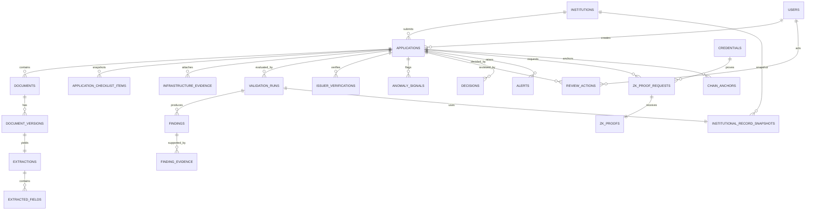

# Data Model — AstraVerify (AICTE Adaptation)

**Status:** target model with as-built delta; Alembic head `4eeaf2dbd8cc`
**Database:** PostgreSQL 16
**ORM / migrations:** SQLAlchemy 2.x + Alembic
**Companion documents:** [`ARCHITECTURE.md`](ARCHITECTURE.md) · [`API_CONTRACTS.md`](API_CONTRACTS.md) · [`SPEC.md`](../SPEC.md)

### 0.1 As-built delta (important)

The implemented schema is in `backend/app/db/models.py`; migrations are under `backend/alembic/versions/`.

**Implemented tables:** `institutions`, `users`, `refresh_tokens`, `application_categories`, `checklist_templates`, `checklist_template_items`, `applications`, `application_checklist_items`, `application_status_history`, `documents`, `document_versions`, `reference_counters`, `approval_history`, `programmes`, `faculty_records`, `compliance_deficiencies`, `ter_payments`, `accreditation_records`, `nocs_permissions`, `extractions`, `extracted_fields`, `rule_sets`, `rules`, `validation_runs`, `findings`, `finding_evidence`, `record_snapshots`, `issuer_keys`, `issued_credentials`, `issuer_verifications`, `anomaly_signals`, `infrastructure_evidence`, `review_actions`, `decisions`, `alerts`, `audit_events`, `zk_proofs`, `zk_challenges`.

**Target-only tables not implemented:** `idempotency_keys`, `security_events`, `outbox_events`, `jobs`, `processing_runs`, `report_exports`, `chain_anchors`, `credential_anchors`.

**Other deltas:**
- ZKP requests are stored in `zk_challenges` (not `zk_proof_requests`); proof rows are `zk_proofs`.
- File records are `issued_credentials` (not `credentials`); snapshots are `record_snapshots`.
- No DB trigger enforces evidence presence; the service and tests enforce it.
- Retention/deletion jobs are not implemented.
- Authentication uses JWT refresh tokens with rotation; no cookie sessions.
- `audit_events` is append-only in application code, not via DB grants.

---

## 1. Conventions

- **Keys:** UUID v4 (`gen_random_uuid()`) for entity IDs; human-readable `reference_no` for applications.
- **Time:** all timestamps `timestamptz` in UTC. API serializes ISO-8601 with `Z`.
- **Naming:** `snake_case` tables/columns; plural table names; `*_id` foreign keys.
- **Enums:** PostgreSQL enum types, mirrored in Python enums and API schemas. New values require a migration.
- **Mutable rows:** carry `version integer` for optimistic locking and `updated_at`.
- **Immutability:** document versions, extraction results, completed validation runs, findings, issuer verifications, record snapshots, and audit events are append-only. See §10.
- **PII:** minimized. Aadhaar is stored only as `last4`; no full Aadhaar, no raw document text outside `extracted_fields`/storage.
- **Money:** `numeric(14,2)`, currency explicit (`INR`).
- **JSONB:** only for flexible evidence/config payloads that are not queried relationally. All JSONB writes are schema-validated in the application.
- **Synthetic flag:** every synthetic/mock record carries `synthetic boolean not null default false`; API responses mirror it.

---

## 2. Enumerations

| Enum | Values |
|---|---|
The table reflects the **implemented** enums in `backend/app/db/enums.py`.

| Enum | Values |
|---|---|
| `role` | `APPLICANT`, `REVIEWER`, `APPROVER`, `ADMIN`, `AUDITOR` |
| `application_status` | `DRAFT`, `SUBMITTED`, `UNDER_REVIEW`, `RECTIFICATION_REQUESTED`, `RESUBMITTED`, `APPROVED`, `REJECTED`, `WITHDRAWN` |
| `checklist_item_status` | `PENDING`, `SATISFIED`, `WAIVED`, `REJECTED` |
| `checklist_template_status` | `DRAFT`, `ACTIVE`, `RETIRED` |
| `document_status` | `UPLOADED`, `STORED`, `PROCESSING`, `PROCESSED`, `FAILED`, `QUARANTINED` |
| `document_type` | `AFFILIATION_CERTIFICATE`, `LAND_LEASE_DOCUMENT`, `FACULTY_DEGREE_CERTIFICATE`, `INSTITUTIONAL_UNDERTAKING`, `OTHER` |
| `extraction_status` | `PENDING`, `COMPLETED`, `LOW_CONFIDENCE`, `UNREADABLE`, `FAILED` |
| `issuer_verification_status` | `VERIFIED`, `MISMATCH`, `NOT_FOUND`, `SOURCE_UNAVAILABLE`, `ERROR` |
| `rule_outcome` | `PASS`, `FAIL`, `INCONCLUSIVE`, `NOT_AVAILABLE`, `NOT_APPLICABLE` |
| `rule_severity` | `BLOCKING`, `ADVISORY`, `INFO` |
| `anomaly_severity` | `LOW`, `MEDIUM`, `HIGH` |
| `rule_set_status` | `DRAFT`, `ACTIVE`, `ARCHIVED` |
| `validation_status` | `PENDING`, `RUNNING`, `COMPLETED`, `FAILED` |
| `credential_status` | `ACTIVE`, `REVOKED`, `EXPIRED` |
| `infrastructure_evidence_type` | `PHOTO`, `VIDEO`, `FLOOR_PLAN`, `CERTIFICATE` |
| `infrastructure_check_status` | `PRESENT`, `MISSING`, `NEEDS_REVIEW` |
| `review_action_type` | `ASSIGN`, `NOTE`, `REQUEST_RECTIFICATION`, `ESCALATE` |
| `decision_type` | `APPROVE`, `REJECT` |
| `alert_type` | `VALIDATION_FAILURE`, `EXPIRED_DOCUMENT`, `PENDING_VERIFICATION`, `UNRESOLVED_DISCREPANCY`, `RECTIFICATION_REQUEST`, `ESCALATION` |
| `alert_status` | `OPEN`, `ACKNOWLEDGED`, `RESOLVED` |
| `zk_proof_status` | `PENDING`, `VERIFIED`, `REJECTED`, `EXPIRED` |
| `zk_chain_status` | `NOT_REQUESTED`, `PENDING`, `ANCHORED`, `FAILED` |
| `audit_actor_type` | `USER`, `SYSTEM` |

Anomaly signals use a free-text `code` with severity, not a fixed anomaly-type enum. The target taxonomy in the original design was not adopted.
| `review_action_type` | `NOTE`, `ASSIGN`, `REQUEST_RECTIFICATION`, `RESPOND_RECTIFICATION`, `ESCALATE`, `RECOMMEND_APPROVE`, `RECOMMEND_REJECT` |
| `decision_outcome` | `APPROVED`, `REJECTED` |
| `alert_status` | `OPEN`, `ACKNOWLEDGED`, `RESOLVED` |
| `job_status` | `QUEUED`, `RUNNING`, `SUCCEEDED`, `FAILED`, `DEAD` |
| `zk_request_status` | `PENDING`, `PROOF_SUBMITTED`, `VERIFIED`, `REJECTED`, `EXPIRED` |
| `zk_proof_status` | `SUBMITTED`, `VERIFIED`, `REJECTED` |
| `chain_anchor_status` | `PENDING`, `SUBMITTED`, `CONFIRMED`, `FAILED`, `REVOKED` |
| `anchor_kind` | `DOCUMENT`, `CREDENTIAL`, `PROOF_RESULT` |
| `credential_status` | `ACTIVE`, `REVOKED`, `EXPIRED` |
| `checklist_item_status` | `PENDING`, `SATISFIED`, `WAIVED`, `REJECTED` |
| `issuer_key_status` | `ACTIVE`, `RETIRED`, `REVOKED` |

---

## 3. Relationship overview

---

## 4. Identity and access

### 4.1 `users`

| Column | Type | Constraints |
|---|---|---|
| `id` | uuid | PK, default `gen_random_uuid()` |
| `email` | citext | unique, not null |
| `password_hash` | text | not null (Argon2id) |
| `full_name` | text | not null |
| `role` | role | not null |
| `institution_id` | uuid | FK → `institutions.id`, nullable (null for AICTE staff) |
| `wallet_did` | text | unique, nullable; used only for the demo ZKP wallet |
| `is_active` | boolean | not null default true |
| `last_login_at` | timestamptz | nullable |
| `created_at`, `updated_at` | timestamptz | not null |
| `version` | integer | not null default 1 |

Indexes: `unique(email)`, `unique(wallet_did) where wallet_did is not null`, `(institution_id)`, `(role, is_active)`.
Rule: `APPLICANT` must have `institution_id`; `REVIEWER`/`APPROVER`/`AUDITOR`/`ADMIN` must not.

### 4.2 `refresh_tokens`

| Column | Type | Constraints |
|---|---|---|
| `id` | uuid | PK |
| `user_id` | uuid | FK → users, not null |
| `jti` | uuid | unique, not null |
| `token_hash` | char(64) | unique, not null |
| `expires_at` | timestamptz | not null |
| `revoked_at` | timestamptz | nullable |
| `replaced_by_jti` | uuid | nullable |
| `created_at` | timestamptz | not null |

Indexes: `(user_id, expires_at)`, `(expires_at)` for cleanup.

### 4.3 `idempotency_keys`

| Column | Type | Constraints |
|---|---|---|
| `id` | uuid | PK |
| `user_id` | uuid | FK → users |
| `endpoint` | text | not null |
| `key` | text | not null |
| `request_hash` | char(64) | not null |
| `response_status` | integer | nullable |
| `response_body` | jsonb | nullable |
| `created_at`, `expires_at` | timestamptz | not null |

Unique: `(user_id, endpoint, key)`. Retention: 24 h.

### 4.4 `security_events`

Append-only: `id`, `event_type` (`LOGIN_FAILED`, `AUTHZ_DENIED`, `RATE_LIMITED`, `UPLOAD_REJECTED`, `TOKEN_REUSE`), `actor_id` nullable, `ip_hash`, `detail jsonb`, `created_at`. Indexed by `(event_type, created_at)`.

---

## 5. Institutions and applications

### 5.1 `institutions`

| Column | Type | Constraints |
|---|---|---|
| `id` | uuid | PK |
| `legal_name` | text | not null |
| `short_name` | text | nullable |
| `aicte_permanent_id` | text | unique nullable |
| `institute_type` | text | nullable |
| `address` | jsonb | nullable |
| `state` | text | nullable |
| `status` | text | not null default `ACTIVE` |
| `synthetic` | boolean | not null default false |
| `created_at`, `updated_at` | timestamptz | not null |

Indexes: `unique(aicte_permanent_id) where aicte_permanent_id is not null`, `(legal_name)`.

### 5.2 `application_categories`

`id`, `code` (unique, e.g. `EOA`), `name`, `description`, `active`, `created_at`.

### 5.3 `checklist_templates`

`id`, `category_id` FK, `version` int, `status` (DRAFT/ACTIVE/RETIRED), `effective_from`, `source_citation` text, `created_by` FK users, `created_at`.
Unique: `(category_id, version)`. Only one `ACTIVE` per category (partial unique index).

### 5.4 `checklist_template_items`

`id`, `template_id` FK, `code`, `title`, `description`, `required` bool, `accepted_document_types text[]`, `record_requirement jsonb` (e.g. `{"record_type":"TER","must_be_paid":true}`), `rule_codes text[]`, `sort_order`.
Unique: `(template_id, code)`.

### 5.5 `applications`

| Column | Type | Constraints |
|---|---|---|
| `id` | uuid | PK |
| `reference_no` | text | unique, not null (`APP-YYYY-NNNNNN`) |
| `institution_id` | uuid | FK → institutions, not null |
| `category_id` | uuid | FK → application_categories |
| `checklist_template_id` | uuid | FK → checklist_templates |
| `cycle` | text | not null (e.g. `2026-27`) |
| `status` | application_status | not null default `DRAFT` |
| `submitted_at` | timestamptz | nullable |
| `assigned_reviewer_id` | uuid | FK → users, nullable |
| `created_by` | uuid | FK → users |
| `created_at`, `updated_at` | timestamptz | not null |
| `version` | integer | not null default 1 |

Indexes: `(institution_id, status)`, `(assigned_reviewer_id, status)`, `(cycle)`, `(status, submitted_at)`.
Constraint: `status != DRAFT` requires `submitted_at`.

### 5.6 `application_checklist_items`

Snapshot of the template at creation: `id`, `application_id` FK, `template_item_id`, `code`, `title`, `required`, `status` (PENDING/SATISFIED/WAIVED/REJECTED), `justification` text, `document_id` nullable, `created_at`, `updated_at`.
Unique: `(application_id, code)`.
Invariant: `WAIVED` requires a non-empty justification and an audit event.

### 5.7 `application_status_history`

`id`, `application_id`, `from_status`, `to_status`, `actor_id`, `reason`, `created_at`. Append-only. Audited in addition to the global audit log.

---

## 6. Documents and processing

### 6.1 `documents`

`id`, `application_id`, `checklist_item_id` nullable, `document_type` text, `status` document_status, `current_version_id` uuid nullable, `created_at`, `updated_at`.
Indexes: `(application_id, document_type)`, `(status)`.

### 6.2 `document_versions` (immutable)

| Column | Type | Constraints |
|---|---|---|
| `id` | uuid | PK |
| `document_id` | uuid | FK → documents |
| `version_no` | integer | not null |
| `storage_key` | text | unique, not null |
| `original_filename` | text | not null |
| `mime_type` | text | not null |
| `size_bytes` | bigint | not null, `<= 104857600` (API enforces 25 MB for OCR documents) |
| `sha256` | char(64) | not null |
| `page_count` | integer | nullable |
| `uploaded_by` | uuid | FK → users |
| `uploaded_at` | timestamptz | not null |
| `synthetic` | boolean | not null default false |

Unique: `(document_id, version_no)`, `(document_id, sha256)`.
Indexes: `(sha256)` for duplicate detection.
No `superseded_by` column: current version is `documents.current_version_id`; history is ordered by `version_no`.

### 6.3 `extractions`

| Column | Type | Constraints |
|---|---|---|
| `id` | uuid | PK |
| `document_version_id` | uuid | unique, FK → document_versions |
| `document_type` | text | nullable |
| `classification_confidence` | numeric(4,3) | nullable |
| `status` | extraction_status | not null |
| `confidence` | numeric(4,3) | nullable |
| `extractor_version` | text | not null |
| `page_count` | integer | nullable |
| `error_code` | text | nullable |
| `error_detail` | text | nullable |
| `created_at`, `completed_at` | timestamptz | not null/nullable |

### 6.4 `extracted_fields`

`id`, `extraction_id` FK, `name`, `raw_value` text, `normalized_value` text, `value_type` (`TEXT/DATE/NUMBER/IDENTIFIER`), `page` int, `bbox` jsonb, `confidence` numeric(4,3), `extractor` text, `created_at`.
Indexes: `(extraction_id, name)`, `(normalized_value)`.

### 6.5 `infrastructure_evidence`

| Column | Type | Constraints |
|---|---|---|
| `id` | uuid | PK |
| `application_id` | uuid | FK → applications |
| `checklist_item_id` | uuid | nullable |
| `document_version_id` | uuid | FK → document_versions |
| `evidence_type` | infrastructure_evidence_type | not null |
| `requirement_code` | text | nullable |
| `captured_at` | date | nullable |
| `status` | infrastructure_evidence_status | not null |
| `notes` | text | nullable |
| `created_at` | timestamptz | not null |

Indexes: `(application_id, evidence_type)`, `(document_version_id)`.
MVP: no CV pipeline; checks are presence/type/recency/requirement mapping.

---

## 7. Institutional records (synthetic AICTE source)

All tables carry `source text`, `synthetic boolean`, `retrieved_at timestamptz`. The adapter populates them from fixtures; no real AICTE data is assumed. Application history is represented by the institution's prior `applications` plus `application_status_history`; the synthetic bundle includes a read-only summary.

| Table | Columns |
|---|---|
| `approval_history` | id, institution_id, application_reference, cycle, approval_type, status, valid_from, valid_until, programmes_summary jsonb |
| `programmes` | id, institution_id, code, name, level, intake int, accreditation_status, valid_until |
| `faculty_records` | id, institution_id, faculty_ref, full_name, designation, qualification, experience_months int, programme_code, approved_status |
| `compliance_deficiencies` | id, institution_id, code, description, severity, status, cycle, resolved_at |
| `ter_payments` | id, institution_id, cycle, reference, amount numeric(14,2), currency, status (`PAID/PENDING/FAILED`), paid_at |
| `accreditation_records` | id, institution_id, body, grade, reference, valid_until, status |
| `nocs_permissions` | id, institution_id, authority, reference, valid_until, status |

Indexes: `(institution_id)`, `(institution_id, cycle)` where applicable, `(valid_until)`.

### 7.1 `institutional_record_snapshots` (immutable)

| Column | Type | Constraints |
|---|---|---|
| `id` | uuid | PK |
| `application_id` | uuid | FK → applications |
| `validation_run_id` | uuid | nullable, FK → validation_runs |
| `payload` | jsonb | not null (normalized bundle of all records above) |
| `source` | text | not null |
| `synthetic` | boolean | not null |
| `retrieved_at` | timestamptz | not null |
| `checksum` | char(64) | not null (SHA-256 of canonical payload) |

A snapshot is written before evaluation and referenced by the run; it is never updated.

---

## 8. Rules and findings

### 8.1 `rule_sets`

`id`, `code`, `version` int, `status` rule_set_status, `effective_from`, `source_citation`, `description`, `checksum` char(64), `created_by`, `created_at`.
Unique: `(code, version)`. Partial unique: one `ACTIVE` per `code`.
Immutable once `ACTIVE`; changes create a new version.

### 8.2 `rules`

`id`, `rule_set_id`, `code`, `title`, `description`, `rule_type` (`REQUIRED_DOCUMENT`, `DOCUMENT_EXPIRY`, `FIELD_EQUALS_RECORD`, `FIELD_CROSS_DOCUMENT`, `FIELD_CROSS_RECORD`, `DATE_ORDER`, `IDENTIFIER_FORMAT`, `PAYMENT_STATUS`, `INFRASTRUCTURE_EVIDENCE`, `CUSTOM`), `severity`, `config` jsonb (schema-validated per type), `evidence_requirements` jsonb, `recommended_action` text, `source_citation` text, `created_at`.
Unique: `(rule_set_id, code)`.

### 8.3 `validation_runs`

| Column | Type | Constraints |
|---|---|---|
| `id` | uuid | PK |
| `application_id` | uuid | FK → applications |
| `rule_set_id` | uuid | FK → rule_sets |
| `snapshot_id` | uuid | FK → institutional_record_snapshots, nullable until evaluation starts |
| `status` | validation_status | not null |
| `triggered_by` | uuid | FK → users (or null for system) |
| `started_at`, `completed_at` | timestamptz | |
| `summary` | jsonb | counts by outcome/severity |
| `error_code` | text | nullable |
| `created_at` | timestamptz | not null |

Indexes: `(application_id, created_at desc)`, `(status)`.
Immutable after `COMPLETED` (only `status`, `completed_at`, `summary` are set during the run).

### 8.4 `findings` (immutable)

`id`, `validation_run_id`, `rule_id`, `outcome` finding_outcome, `severity`, `explanation` text, `recommended_action` text, `created_at`.
Indexes: `(validation_run_id, outcome)`, `(severity)`.
Invariant: `outcome != FAIL/INCONCLUSIVE` does not require evidence; `FAIL`, `INCONCLUSIVE`, `NOT_AVAILABLE` all carry an explanation and recommended action. Evidence is required for `FAIL` and `INCONCLUSIVE` where the rule has evidence requirements.

### 8.5 `finding_evidence` (immutable)

| Column | Type | Constraints |
|---|---|---|
| `id` | uuid | PK |
| `finding_id` | uuid | FK → findings |
| `evidence_kind` | text | `DOCUMENT_FIELD`, `DOCUMENT_PAGE`, `INSTITUTIONAL_RECORD`, `ISSUER_RESPONSE`, `ANOMALY`, `ZKP` |
| `document_version_id` | uuid | nullable |
| `extracted_field_id` | uuid | nullable |
| `record_type` | text | nullable |
| `record_id` | uuid | nullable |
| `page` | integer | nullable |
| `bbox` | jsonb | nullable |
| `snippet` | text | nullable |
| `created_at` | timestamptz | not null |

Constraint: at least one of `document_version_id`, `record_id`, or `extracted_field_id` is non-null.

---

## 9. Issuer verification, anomaly, ZKP, chain

### 9.1 `issuer_keys`

`id`, `issuer_did`, `key_id`, `public_key` text (base64), `algorithm` (`Ed25519`), `status` issuer_key_status, `valid_from`, `valid_until`, `created_at`.
Unique: `(issuer_did, key_id)`.

### 9.2 `credentials` (immutable except status)

| Column | Type | Constraints |
|---|---|---|
| `id` | uuid | PK |
| `credential_id` | text | unique |
| `holder_did` | text | not null |
| `issuer_did` | text | not null |
| `issuer_key_id` | uuid | FK → issuer_keys |
| `document_type` | text | not null |
| `fields` | jsonb | non-sensitive fields only |
| `commitments` | jsonb | e.g. `{"cgpa":{"scheme":"poseidon-bn254-v1","value":"123456789..."}}` (canonical decimal field element) |
| `status` | credential_status | not null default `ACTIVE` |
| `issued_at`, `expires_at` | timestamptz | |
| `signature` | text | Ed25519 over canonical JSON |
| `canonicalization` | text | `RFC8785` |
| `created_at` | timestamptz | not null |

MVP note: this is **not** full W3C VC Data Integrity conformance. It is Ed25519 over RFC 8785 canonical JSON, and must be labeled as such.

### 9.3 `issuer_verifications` (immutable)

`id`, `document_id`, `document_version_id`, `adapter`, `source`, `simulated` bool, `status` verification_status, `request_ref`, `response_ref`, `response_summary` jsonb, `verified_fields` jsonb, `retrieved_at`, `created_at`.
Indexes: `(document_id, created_at desc)`, `(status)`, `(simulated)`.

### 9.4 `anomaly_signals` (immutable)

`id`, `document_version_id`, `application_id`, `anomaly_type`, `score` numeric(5,4), `method_version` text, `evidence` jsonb, `explanation` text, `created_at`.
Indexes: `(document_version_id)`, `(application_id, anomaly_type)`.

### 9.5 `zk_challenges` (implemented)

| Column | Type | Constraints |
|---|---|---|
| `id` | uuid | PK |
| `application_id` | uuid | FK → applications, indexed |
| `created_by` | uuid | FK → users (`RESTRICT`) |
| `request_hash` | text | unique, not null |
| `audience` | text | not null |
| `threshold` | text | not null; server-issued |
| `circuit_name` | text | not null, default `faculty_threshold` |
| `circuit_version` | text | not null, default `2.0.0` |
| `expires_at` | timestamptz | not null |
| `consumed_at` | timestamptz | nullable; set only after successful verification |
| `created_at` | timestamptz | not null |

Index: `(application_id)`. There is no credential FK: the current challenge flow is not credential-bound.

### 9.6 `zk_proofs` (implemented; immutable except chain fields)

| Column | Type | Constraints |
|---|---|---|
| `id` | uuid | PK |
| `application_id` | uuid | FK → applications, indexed |
| `document_version_id` | uuid | nullable FK → document_versions (`SET NULL`) |
| `circuit_name`, `circuit_version` | text | not null |
| `request_hash` | text | not null |
| `commitment`, `nullifier`, `threshold` | text | not null; `nullifier` globally unique |
| `public_signals` | jsonb | not null, fixed five-element order |
| `proof_json` | jsonb | not null; never returned by the API |
| `status` | `zk_proof_status` | `PENDING`/`VERIFIED`/`REJECTED`/`EXPIRED` |
| `vkey_hash` | text | not null |
| `verified_by` | uuid | nullable FK → users |
| `verified_at` | timestamptz | nullable |
| `verification_result` | jsonb | not null, default `{}` |
| `chain_status` | `zk_chain_status` | `NOT_REQUESTED`/`PENDING`/`ANCHORED`/`FAILED` |
| `chain_tx_hash`, `chain_network` | text | nullable |
| `anchored_at` | timestamptz | nullable |
| `error_message` | text | nullable |
| `created_at`, `updated_at` | timestamptz | not null |

Public-signal order invariant (enforced in code and tests): `[valid, nullifier, commitment, threshold, requestHash]`.

### 9.7 Chain state

There is **no `chain_anchors` or `credential_anchors` table**. Each proof row carries its own `chain_status`, `chain_tx_hash`, `chain_network`, `anchored_at`, and `error_message`. Only proof anchoring is implemented; document/credential anchoring is not.

### 9.8 Edge case

Multiple challenges may be created for an application; each has a unique `request_hash`. A challenge can be consumed at most once. Nullifiers are unique across all proofs, so a successful proof cannot be replayed across challenges.

---

## 10. Review, alerts, audit

### 10.1 `review_actions` (immutable)

`id`, `application_id`, `actor_id`, `action_type`, `rationale` text (min 10 chars for non-note actions), `payload` jsonb, `created_at`.
Indexes: `(application_id, created_at)`.

### 10.2 `decisions`

`id`, `application_id`, `approver_id`, `decision` decision_outcome, `rationale`, `scope` text, `decided_at`, `created_at`.
Unique: one final decision per application: `unique(application_id)`.
Only `APPROVER` role may insert.

### 10.3 `alerts`

`id`, `application_id`, `type` (`MISSING_DOCUMENT`, `EXPIRED_DOCUMENT`, `PENDING_VERIFICATION`, `ANOMALY`, `UNRESOLVED_FINDING`, `ANCHOR_FAILED`), `severity`, `status` alert_status, `dedupe_key` unique, `message`, `created_at`, `acknowledged_by`, `acknowledged_at`, `resolved_at`.
Indexes: `(application_id, status)`, `(status, severity)`.
`dedupe_key` is deterministic (e.g., `app:{id}:finding:{finding_id}`) so re-runs do not duplicate alerts.

### 10.4 `audit_events` (append-only)

| Column | Type | Constraints |
|---|---|---|
| `seq` | bigserial | PK |
| `id` | uuid | unique, not null |
| `actor_type` | text | `USER`, `SYSTEM`, `ADAPTER` |
| `actor_id` | text | nullable |
| `action` | text | not null |
| `object_type` | text | not null |
| `object_id` | text | not null |
| `before` | jsonb | nullable |
| `after` | jsonb | nullable |
| `request_id` | text | nullable |
| `ip_hash` | char(64) | nullable |
| `created_at` | timestamptz | not null |
| `prev_hash` | char(64) | not null |
| `event_hash` | char(64) | unique, not null |

Hash: `event_hash = SHA-256(prev_hash || RFC8785({id, actor_type, actor_id, action, object_type, object_id, before, after, request_id, ip_hash, created_at}))`. `seq` orders the chain and is assigned by the database; it is not part of the hash, so the hash can be computed before insert. Reordering rows breaks `prev_hash` linkage and is detected by verification.
Indexes: `(object_type, object_id, seq)`, `(actor_id, created_at)`, `(created_at)`.

### 10.5 Audit chain state

There is **no separate `audit_chain_state` table**. `audit_events` has a unique `sequence`, `previous_hash`, and `event_hash`; each insert selects the latest event and appends. Verification recomputes the chain. Concurrent writers rely on the transaction/unique constraint; a serialized writer is a production hardening item.

### 10.6 `report_exports` (not implemented)

No report export table or endpoint exists. Findings and review data are available through APIs; formal PDF/JSON report generation remains a gap.

---

## 11. Jobs, outbox, and reliability (not implemented)

No `outbox_events`, `jobs`, or `processing_runs` tables exist. Processing and validation run inline by default (`PROCESS_DOCUMENTS_INLINE=true`). The only asynchronous-looking behavior is upload returning `202` while processing completes in the request unless configured otherwise. A durable queue/outbox is a production hardening item.

---

## 12. Integrity rules and invariants

1. `applications.reference_no` is generated server-side and never reused.
2. A `SUBMITTED`/`RESUBMITTED` application has at least one `validation_run`; a `DRAFT` has none.
3. `validation_runs.snapshot_id` references a snapshot created before evaluation.
4. `validation_runs.rule_set_id` references an `ACTIVE` or `RETIRED` rule set; never a `DRAFT`.
5. `findings` reference a rule from the same rule set as the run (enforced in service + DB trigger recommended).
6. A `FAIL`/`INCONCLUSIVE` finding with evidence requirements has ≥ 1 `finding_evidence` row.
7. `documents.current_version_id` points to the greatest `version_no` for that document.
8. `document_versions.storage_key` is immutable and content-addressed by `sha256` in the bucket key (e.g. `documents/{sha256[0:2]}/{sha256}`).
9. `zk_proofs.nullifier` is globally unique.
10. `zk_challenges.request_hash` is unique and server-derived; a challenge is consumed at most once, only after successful verification.
11. A proof row carries its own chain status; there is no separate anchor table.
12. `audit_events` are insert-only in application code; the chain is verified by recomputation.
13. `decisions` is unique per application; only `APPROVER` can insert.
14. Synthetic rows are flagged and never mixed into a “verified” state without the flag propagating to API/UI.
15. Deleting is limited to `DRAFT` applications and is audited; documents are retained per policy.

---

## 13. Indexing and performance notes

- Hot paths: application list by institution/status; reviewer queue by assignee/status; document versions by document; findings by run; alerts by status; audit by object.
- Use `created_at desc` indexes for history endpoints.
- JSONB GIN indexes only where filtering is required (e.g., `rules.config` is not filtered; no GIN needed initially).
- Pagination is keyset-based for audit/alerts; offset-based acceptable elsewhere.
- `extracted_fields` can grow; partition by `created_at` if the corpus grows (not needed for MVP).
- Avoid N+1 in case view: use explicit joins/selectinload.

---

## 14. Migrations, seeding, and retention

- **Extensions:** `citext` (case-insensitive email) and `pgcrypto` (`gen_random_uuid()`; built in on PostgreSQL 13+ but enabled explicitly). Created in the first migration.
- **Circular foreign keys:** `documents.current_version_id` ↔ `document_versions.document_id` and `validation_runs.snapshot_id` ↔ `institutional_record_snapshots.validation_run_id` are added with `ALTER TABLE` after both tables exist, or declared `DEFERRABLE INITIALLY DEFERRED`.
- **Alembic** with one migration per phase; autogenerate reviewed manually.
- Naming convention configured in SQLAlchemy metadata for stable constraint names.
- **Seed** (`python -m app.seed`): idempotent synthetic demo data — 1 admin, 1 reviewer, 1 approver, 1 auditor, 2 applicant users, 2 institutions, EoA category and checklist, rule sets, institutional records, demo issuer key. Password defaults to `ChangeMe123!` unless `SEED_PASSWORD` is set. The seeder does not create applications or documents; use the API/console or tests for those.
- **Tests** use PostgreSQL `astra_test`; the suite runs migrations/seed helpers, not `create_all`.
- **Retention job**: **not implemented.** No `RETENTION_DAYS` enforcement, automated deletion, or archival exists. This is a documented production gap.
- **Backups**: out of scope for the demo.

---

## 15. Data protection classification

| Data | Classification | Handling |
|---|---|---|
| Applicant credentials (password hash, tokens) | Secret | Argon2id; hashed tokens; never logged |
| Institutional records | Confidential | Private storage; role-scoped; synthetic in MVP |
| Uploaded documents | Confidential | Private bucket, SSE, presigned access |
| Extracted fields | Confidential | DB access restricted; no list exposure |
| Audit events | Confidential / integrity-critical | Append-only, hash chain, restricted reads |
| Chain payloads | Public | Hashes/commitments only; no PII |
| ZKP private values/blinding | Secret (holder-only) | Never sent to server; wallet-local |
| Public signals | Public | Threshold, commitment, nullifier, request hash |

---

## 16. Open data-model questions

1. Confirm TER field semantics (status values, cycle, amount) before seeding rules.
2. Confirm the exact AICTE permanent-ID format and whether multiple IDs per institution are possible.
3. Confirm whether faculty records should be scoped per programme or per institution (MVP assumes per institution with `programme_code`).
4. Confirm retention periods.
5. Confirm whether application categories beyond EoA must be modeled now (schema supports them; MVP seeds EoA only).
